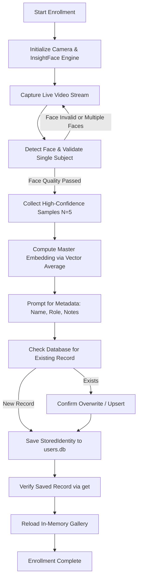

# Workflow: Enroll New Identity

This workflow outlines the step-by-step procedure for enrolling a new member into the Remote Face Recognition system (`users.db`). It enforces quality checks, multi-frame embedding aggregation, and atomic persistence.

---

## Prerequisites
- A connected webcam or IP camera feed, or a directory of clean portrait photos.
- InsightFace `FaceAnalysis` initialized (`buffalo_l`).
- Initialized `DatabaseManager`.

---

## Step-by-Step Enrollment Procedure



### Step 1: Initialize Database and Vision Engine
```python
from database import DatabaseManager, StoredIdentity
from face_engine import FaceAnalysis  # or custom InsightFace wrapper
import cv2
import numpy as np

db = DatabaseManager("users.db")
engine = FaceAnalysis(name="buffalo_l", providers=["CPUExecutionProvider"])
engine.prepare(ctx_id=0, det_size=(640, 640))
```

### Step 2: Acquire Frame and Perform Quality Gate
During capture:
1. Ensure exactly **one** face is visible:
   ```python
   faces = engine.get(frame)
   if len(faces) != 1:
       # Prompt user to adjust positioning (reject 0 or >1 faces)
       continue
   ```
2. Verify quality metrics:
   - `face.det_score >= 0.70`
   - Bounding box width $\ge 90$ px and height $\ge 90$ px
   - Pose angle: check that the user is looking directly at the camera.

### Step 3: Multi-Frame Sample Collection
Collect between 5 to 10 valid embeddings across consecutive frames to prevent momentary facial distortion or blink artifacts:
```python
samples = []
while len(samples) < 5:
    ret, frame = cap.read()
    if not ret:
        break
    faces = engine.get(frame)
    if len(faces) == 1 and faces[0].det_score >= 0.70:
        emb = faces[0].embedding.astype(np.float32)
        emb /= np.linalg.norm(emb)
        samples.append(emb)
```

### Step 4: Compute Normalized Master Embedding
Aggregate the collected samples into a single master template:
```python
master_embedding = np.mean(np.stack(samples, axis=0), axis=0)
master_embedding /= np.linalg.norm(master_embedding)
master_embedding = master_embedding.astype(np.float32)
```

### Step 5: Metadata Entry & Storage
Prompt the operator for user information:
```python
name = input("Enter member full name: ").strip()
role = input("Enter role (e.g., Admin, Student, Staff): ").strip()
details = {
    "role": role,
    "enrolled_at": datetime.utcnow().isoformat(),
    "sample_count": len(samples)
}

identity = StoredIdentity(
    name=name,
    master_embedding=master_embedding,
    details=details
)

db.save(identity)
print(f"Successfully enrolled {name}!")
```

### Step 6: Verification
Verify that the record was correctly written to the SQLite database and can be retrieved as a valid 512-D float32 array:
```python
saved = db.get(name)
assert saved is not None
assert saved.master_embedding.shape == (512,)
assert saved.master_embedding.dtype == np.float32
```
