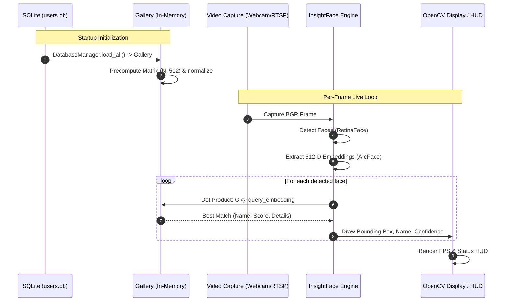

# Workflow: Run Live Face Recognition

This workflow describes the procedure for running real-time, low-latency face recognition using InsightFace and the vectorized in-memory `Gallery` cache.

---

## 1. Pipeline Architecture



---

## 2. Operational Steps

### Step 1: Preload Gallery into Memory
Never query SQLite per video frame. Load the entire identity dataset at application boot:
```python
from database import DatabaseManager, Gallery
import numpy as np

db = DatabaseManager("users.db")
gallery: Gallery = db.load_all()

if gallery.is_empty():
    print("[WARNING] Gallery is empty. Run the enrollment workflow first.")
else:
    print(f"[INFO] Loaded {len(gallery)} identities into gallery cache.")

names, matrix, details = gallery.get_matrix()
```

### Step 2: Initialize Vision Engine
Configure InsightFace with target execution providers:
```python
from insightface.app import FaceAnalysis

engine = FaceAnalysis(name="buffalo_l", providers=["CUDAExecutionProvider", "CPUExecutionProvider"])
engine.prepare(ctx_id=0, det_size=(640, 640))
```

### Step 3: Stream Ingestion & Processing Loop
1. Open the video source (`0` for local USB camera or RTSP URL for remote IP stream):
   ```python
   cap = cv2.VideoCapture(0)
   cap.set(cv2.CAP_PROP_BUFFERSIZE, 1)  # Reduce latency on IP streams
   ```
2. For each incoming frame:
   - Pass the BGR frame directly to `engine.get(frame)`.
   - For every detected face:
     - Normalize the embedding:
       $$\hat{\mathbf{e}} = \frac{\mathbf{e}}{\|\mathbf{e}\|_2}$$
     - Perform batch matrix dot product against the precomputed gallery matrix:
       $$\mathbf{s} = \text{matrix} \cdot \hat{\mathbf{e}}$$
     - If $\max(\mathbf{s}) \ge \text{threshold}$ (default: $0.45$):
       Retrieve corresponding `name = names[idx]` and `role = details[idx].get("role", "")`.
     - Else:
       Label as `"Unknown"`.
3. Draw UI annotations:
   - Green bounding box `(0, 255, 0)` for recognized identities.
   - Red or orange bounding box `(0, 0, 255)` for `"Unknown"`.
   - Label with name and cosine confidence score (e.g., `"Alice (0.78)"`).
   - Draw FPS counter in top-left corner.

### Step 4: Interactive Key Bindings
- `q`: Terminate video capture and cleanly release resources.
- `r`: Reload gallery from `users.db` without restarting the process.

### Step 5: Graceful Shutdown
Always wrap the stream loop in a `try...finally` block:
```python
try:
    # streaming loop
    ...
finally:
    cap.release()
    cv2.destroyAllWindows()
```
